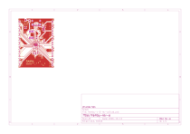

# frambu

## Revisiones

- `v-0-rev-a`: en diseño, única revisión presente en el repositorio.

## Esquemático y placa (v-0-rev-a)

Generados automáticamente por GitHub Actions a partir de `frambu-v-0-rev-a/frambu-v-0-rev-a.kicad_sch` y `.kicad_pcb` en cada push que los modifica.

## Bill of materials (v-0-rev-a)

Generado a partir de `frambu-v-0-rev-a/frambu-v-0-rev-a.kicad_sch`. No confundir con `frambu-v-0-rev-a/bom.csv`, que se escribe a mano para generar la biblioteca local.

<!-- BOM_TABLE_START -->

| Referencias | Cantidad | Valor | Huella | LCSC | Descripción |
| --- | --- | --- | --- | --- | --- |
| C1, C2 | 2 | 15p | frambu-v-0-rev-a:C0402 | C1548 | Condensador |
| C3, C6, C15 | 3 | 10u | frambu-v-0-rev-a:C0402 | C15525 | Condensador |
| C4, C7, C8, C9, C10, C11, C12, C13, C16 | 9 | 100n | frambu-v-0-rev-a:C0402 | C307331 | Condensador |
| C5, C14 | 2 | 1u | Capacitor_SMD:C_0805_2012Metric | C77083 | Condensador |
| J1 | 1 | USB_C_Receptacle_USB2.0_16P | Connector_USB:USB_C_Receptacle_HRO_TYPE-C-31-M-12 | C165948 | Conector USB-C |
| J2 | 1 | pico_pines_1-20 | Connector_PinSocket_2.54mm:PinSocket_1x20_P2.54mm_Vertical | *(sin código)* | Connector_Generic:Conn_01x20 |
| J3 | 1 | SWD | Connector_PinHeader_2.54mm:PinHeader_1x03_P2.54mm_Vertical | *(sin código)* | Connector_Generic:Conn_01x03 |
| J5 | 1 | pico_pines_40-21 | Connector_PinSocket_2.54mm:PinSocket_1x20_P2.54mm_Vertical | *(sin código)* | Connector_Generic:Conn_01x20 |
| R1, R5 | 2 | 1k | Resistor_SMD:R_0805_2012Metric | C2907232 | Resistencia |
| R2 | 1 | 10k | frambu-v-0-rev-a:R0402 | C25744 | Resistencia |
| R3, R4 | 2 | 5k1 | frambu-v-0-rev-a:R0402 | C25905 | Resistencia |
| R6, R7 | 2 | 27 | frambu-v-0-rev-a:R0402 | C25100 | Resistencia |
| SW1 | 1 | PTS 636 | frambu-v-0-rev-a:KEY-SMD_L6.0-W3.5-LS8.7 | C2689642 | Botón BOOTSEL |
| U1 | 1 | W25Q128JVS | frambu-v-0-rev-a:SOIC-8_L5.3-W5.3-P1.27-LS8.0-BL | C97521 | Memoria flash QSPI de 128 Mbit |
| U2 | 1 | RP2040 | Package_DFN_QFN:QFN-56-1EP_7x7mm_P0.4mm_EP3.2x3.2mm | C2040 | Microcontrolador RP2040 |
| U3 | 1 | AMS1117-3.3 | frambu-v-0-rev-a:SOT-89-3_L4.5-W2.5-P1.50-LS4.2-BR | C880752 | Regulador lineal (LDO) de 3,3 V |
| Y1 | 1 | 12MHz | Crystal:Crystal_SMD_3225-4Pin_3.2x2.5mm | C20625731 | Cristal |

32 componentes en total.

<!-- BOM_TABLE_END -->
